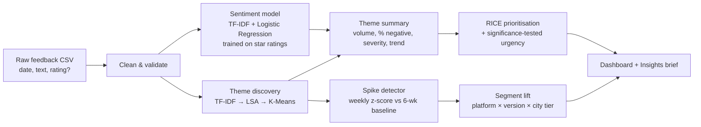

# SignalSift: AI Voice-of-Customer Engine

**Turns thousands of raw user reviews into a ranked product backlog, and raises an alert when a new problem starts to spread.**

Product teams get far more feedback than anyone can read. App reviews, support tickets and survey comments pile up, and the loudest anecdote often wins the roadmap debate. SignalSift reads all of it, finds the themes, measures how much each one hurts, spots sudden spikes, and ranks what to fix first with a transparent RICE score.

> Built as an end-to-end product case study: problem discovery, PRD, ML system, dashboard, metrics, launch plan and decision log.

---

## The problem

| Who | Pain today |
|---|---|
| Product Manager | Spends hours a week skimming reviews; prioritises by gut feel or by whoever escalates loudest. |
| Engineering Manager | Learns about a broken release from Twitter or a VP, days after users did. |
| Support Lead | Sees the same complaint 200 times but cannot turn it into a roadmap item. |

**Problem statement:** *PMs at consumer apps cannot turn high-volume unstructured feedback into prioritised, evidence-backed decisions quickly enough to catch regressions or argue for the right roadmap.*

## What SignalSift does

1. **Understands sentiment.** A text classifier trained on star ratings (weak labels) scores every comment, including feedback that has no rating.
2. **Discovers themes without labels.** TF-IDF → LSA → K-Means groups feedback into themes and names each one from its top terms.
3. **Detects spikes.** Each theme's weekly volume is compared with its 6-week baseline; a jump past 3.5 standard deviations raises an alert.
4. **Finds who is affected.** Segment-lift analysis points to where a theme is concentrated (for example *Android + app v4.2*).
5. **Prioritises with RICE.** Reach, Impact, Confidence and Effort are computed from the data. A significance-tested urgency boost is added for themes that are growing.
6. **Writes the brief.** It generates a one-page insights brief a PM can paste into a team update.

## Results on the sample dataset

The sample is 3,078 synthetic reviews of **FreshKart**, a fictional 10-minute grocery app (Apr–Sep 2026). Two real-world-style incidents were planted so the system could be tested against a known truth:

| Check | Result |
|---|---|
| Theme discovery vs. labelled themes | **ARI 0.98** (1.0 = perfect), with no labels used in training |
| Sentiment model (hold-out) | **82% accuracy**, macro F1 0.79, **88% recall on negative feedback** |
| Incident 1: UPI payment bug in app v4.2 (shipped 18 Aug) | Alert in the **week of 17 Aug** (z = 7.0); pinpointed to **Android + v4.2** (2.1x lift) |
| Incident 2: new handling fee (1 Jul) | Alert in the **week of 13 Jul** (z = 3.9) |
| False alarms across 8 themes over 6 months | **0** |
| #1 ranked opportunity | Payment failures, ahead of the larger but less severe delivery-delay theme |

Reading 3,000 reviews by hand at about 30 seconds each takes about 25 hours. The pipeline runs in under 10 seconds on a laptop.

See the generated [insights brief](outputs/insights_brief.md) and [backlog](outputs/opportunity_backlog.csv).

## How it works



**How RICE is computed (each input can be challenged in a review):**

| Input | Formula | Why |
|---|---|---|
| Reach | theme share of feedback × monthly active users | Estimates how many users a theme touches |
| Impact (0.25–3) | % negative × severity, where severity = 1 + 2 × share mentioning money loss, crashes or safety | A crash that costs users money matters more than a missing dark mode |
| Confidence | 1.0 / 0.8 / 0.5 by evidence volume | Less evidence means lower confidence |
| Effort | Person-weeks, edited by the team in the dashboard | Engineering owns the estimate |
| Urgency | 1 + growth, only if growth passes a Poisson test (p < 0.05) | Real growth raises urgency; noise does not |

## Product documents

| Doc | What's inside |
|---|---|
| [PRD](docs/PRD.md) | Problem, personas, user stories, P0/P1/P2 requirements, success metrics, risks |
| [Discovery plan](docs/DISCOVERY.md) | Assumptions to test, interview guide, competitive landscape |
| [Metrics & launch plan](docs/METRICS_AND_LAUNCH.md) | North-star metric, HEART metrics, guardrails, phased rollout |
| [Decision log](docs/DECISIONS.md) | Trade-offs: classic ML vs LLMs, why 8 themes, alert threshold, weak labels |
| [Demo script](docs/DEMO_SCRIPT.md) | 5-minute walkthrough for a presentation |

## Run it

Requires Python 3.10+.

```bash
git clone https://github.com/anamikatripathi2023-ui/signalsift-ai-feedback-engine.git
cd signalsift-ai-feedback-engine
python -m venv .venv
# Windows: .venv\Scripts\activate    macOS/Linux: source .venv/bin/activate
pip install -r requirements.txt

streamlit run app.py                         # interactive dashboard
python -m signalsift.pipeline --out outputs  # command-line brief
python -m pytest                             # 14 tests
```

To analyse your own feedback, upload a CSV with `date` and `text` columns in the dashboard sidebar. `rating`, `platform`, `app_version` and `city_tier` unlock extra analysis.

To regenerate the sample data: `python data/generate_reviews.py --seed 7`.

## Project structure

```
signalsift/
├── app.py                    # Streamlit dashboard (6 tabs)
├── signalsift/
│   ├── preprocess.py         # validation, cleaning, rating → sentiment labels
│   ├── sentiment.py          # weak-supervision sentiment classifier
│   ├── themes.py             # unsupervised theme discovery + naming
│   ├── trends.py             # weekly trends, spike alerts, segment lift
│   ├── prioritize.py         # RICE scoring + significance-tested urgency
│   ├── brief.py              # auto-generated insights brief
│   └── pipeline.py           # end-to-end orchestration + CLI
├── data/                     # synthetic data generator + sample CSV
├── outputs/                  # generated brief, backlog, alerts
├── docs/                     # PRD, discovery, metrics, decisions, demo script
└── tests/                    # unit, model-quality and app smoke tests
```

## Limitations and next steps

- **Synthetic data.** The sample is generated, so the planted incidents can be checked against a known truth. Next step: run on a public review dataset and validate with a team that uses it.
- **Bag-of-words understanding.** TF-IDF misses sarcasm and synonyms. A sentence-embedding model or an LLM labelling pass is the next upgrade (see the [decision log](docs/DECISIONS.md) for why it is not v1).
- **English only.** A Hindi/Hinglish model is the most-requested extension for Indian markets.
- **Reach is an estimate.** It assumes feedback mirrors the user base. Joining with product analytics (for example, payment-failure events) would make it exact.

## Part of a 3-project product series

One fictional product (FreshKart) taken through the full product lifecycle:

| Stage | Project |
|---|---|
| Discover: what should we build? | [SignalSift: AI Voice-of-Customer Engine](https://github.com/anamikatripathi2023-ui/signalsift-ai-feedback-engine) |
| Launch: does it work, should we ship? | [ShipOrSkip: Experiment Decision Engine](https://github.com/anamikatripathi2023-ui/shiporskip-experiment-decision-engine) |
| Monetise: what should we charge? | [PricePilot: Pricing & Business Case Simulator](https://github.com/anamikatripathi2023-ui/pricepilot-pricing-business-case) |

## License

MIT. See [LICENSE](LICENSE).
