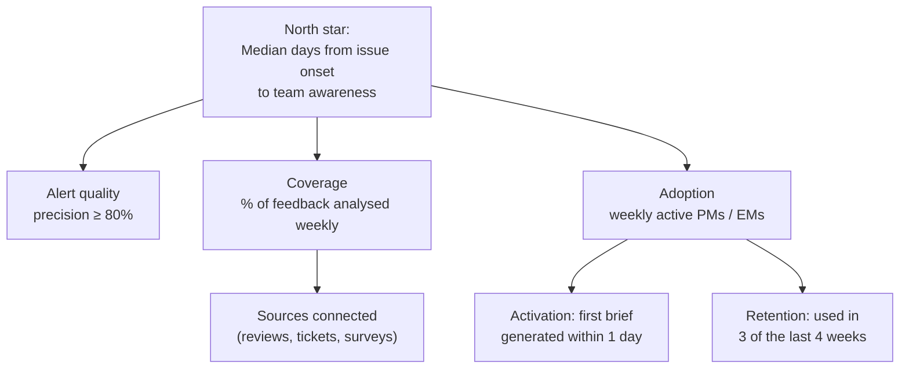

# Metrics and launch plan

## Metric tree

Why this north star: SignalSift is valuable when it changes *when* a team learns something. Shorter time-to-awareness means fewer users hit a bug, and the metric can be measured from incident post-mortems.

## HEART metrics

| | Goal | Signal | Metric |
|---|---|---|---|
| **Happiness** | PMs trust the output | Post-brief survey | % rating the brief "useful" ≥ 4/5 |
| **Engagement** | Used in real decisions | Briefs shared, backlog exported | Briefs shared per team per month |
| **Adoption** | Teams start using it | First upload | New teams activated per month |
| **Retention** | Becomes a habit | Weekly usage | 4-week retention of activated teams |
| **Task success** | Finds the right issues | Alert confirmed by owning team | Alert precision; theme audit ARI |

## Guardrails

- **Alert fatigue:** no more than 2 alerts per team per week on average. If this is breached, raise the threshold.
- **Triage time:** PM time on feedback must go down. A rise means the tool adds work.
- **Privacy:** zero raw feedback exported outside the team's environment.

## Phased rollout

| Phase | Who | Duration | Exit criteria |
|---|---|---|---|
| 0. Dogfood | Author + 1 PM | 2 weeks | Brief generated weekly; no blocking bugs |
| 1. Beta | 3 product teams (payments, delivery, growth) | 6 weeks | ≥ 2 teams use it 3 of 4 weeks; alert precision ≥ 80% |
| 2. GA | All product teams | — | Self-serve upload; documentation; office hours |

**Beta success review:** a 30-minute session per team, asking "Which decision did this change?" A beta without one concrete changed decision is a failure, whatever the usage numbers say.

## Back-test (done on sample data)

| Incident | Started | Alerted | Delay |
|---|---|---|---|
| UPI payment bug, app v4.2 | 18 Aug 2026 | week of 17 Aug | ≤ 1 week |
| Handling fee introduced | 1 Jul 2026 | week of 13 Jul | ≤ 3 weeks |

False alarms: 0 across 8 themes over 6 months.
